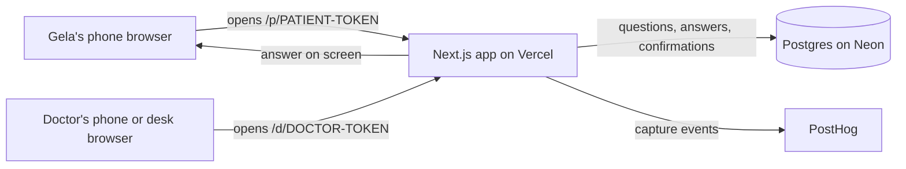

# Architecture

One diagram, one line of why per layer. The question each line answers is not "is this the best technology" but "can this team deploy it at a public URL by the Week 7 lab."

## The diagram

Two private pages and no accounts. Gela's page is reached only through a long random token in his link, which the clinic gives him; it shows his doctor, his questions and the answers. The doctor's page is reached only through her own token link and lists the questions sent to her. Nothing is sent by SMS or email in Sprint 1: Gela reads the answer when he opens his link.

## The stack, one line per layer

| Layer | Choice | Why we can deploy it by Week 7 (who has done it before, or the free tier that makes it easy) |
|---|---|---|
| Hosting | Vercel | Free Hobby plan; every push to `main` deploys in two to three minutes. LM owns the Vercel project and the deploy; the repo is on JP's GitHub account, so JP grants Vercel access to it once (the course's Vercel guide); everyone else only pushes to GitHub |
| App framework | Next.js (App Router), in `app/` | The course's ship-stack guide covers every command from an empty `app/` to a public URL; server routes mean no separate backend to host |
| Database | Postgres on Neon | Hosted, free, no card, Frankfurt region; three small tables are all the journey needs |
| Analytics | PostHog (wired on the first sprint evening, `setup/SHIP-STACK-SETUP.md`) | fixed for the course |
| Messages out | None in Sprint 1 | The answer is shown on Gela's page; SMS, email and Viber notices are on the cut list in `03-build/mvp-boundary.md` |
| Sign-in | None | Gela and his doctor each use a private tokenized link; no passwords, no accounts |

*Layers we deliberately do not have in Sprint 1:* login, messages out (SMS, email, Viber), file uploads, background jobs, booking and scheduling tables (visit types, slots, timetable), AI. All of them are on the cut list.

## The journey through the stack

| Step | Layer that handles it | Event fired |
|---|---|---|
| 1 | Next.js page `/p/[token]` looks up the patient by token and renders his doctor | `patient_opens_doctor_list` (client, once per load, with `source` from `?src=`) |
| 2 | Question form posts to a server route; inserts a `questions` row with the text and `created_at` | `patient_sends_question` (client, after the server returns OK, with `question_id` and `char_count`, never the text) |
| 3 | `/d/[token]` lists the doctor's open questions; the answer form updates the row with `answer` and `answered_at` | `doctor_answers_question` (client, after the server returns OK, with `minutes_since_question`) |
| 4 | `/p/[token]` shows the answer; the first time it is shown, the row gets `patient_viewed_at` | `patient_views_answer` (client, once, when `patient_viewed_at` was empty, with `minutes_since_answer`) |
| 5 | "This solved it, no trip needed" posts to a server route; sets `patient_confirmed_at` only if it is still empty | `patient_confirms_remote_resolution` (client, in the tap handler after the server returns OK, `resolution_type` `answer`) |

## Secrets and data

- Secrets live in: `app/.env.local` (`DATABASE_URL`, the PostHog key and host), never committed; the repo's `.gitignore` lists `.env` and `.env.local`, checked by LM before the first push of `app/`. The same values are pasted into Vercel's environment variables.
- Personal data we store, and where: in the `patients` table a first name and a random link token; in `questions` the question text and the doctor's answer, which are health information. Both stay in Neon only: never on an event (events carry ids, counts and minutes), never in a log line, never in the repo. Doctors are a small table with a display name, specialty and their own token.
- Tables in Sprint 1: `doctors`, `patients`, `questions` (`id`, `patient_id`, `doctor_id`, `body`, `created_at`, `answer`, `answered_at`, `patient_viewed_at`, `patient_confirmed_at`). `patient_confirmed_at` is what the reconcile check in `03-build/analytics/event-schema.md` counts.
- The one thing in this design most likely to break on deploy day: `patient_confirms_remote_resolution` firing twice, the failure named in the reconcile plan. If the capture call sits on the render instead of the tap, or a second tap is not blocked, the north star doubles. First test in the Week 7 lab: tap "This solved it" twice and reload; one `patient_confirmed_at`, one event.
