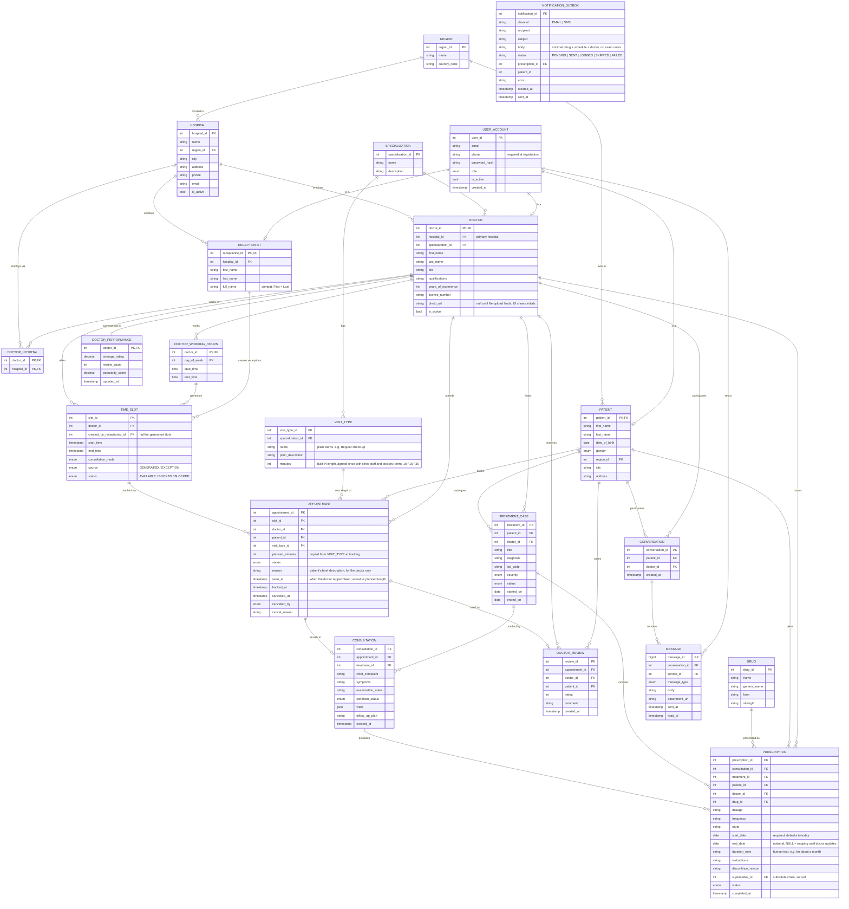
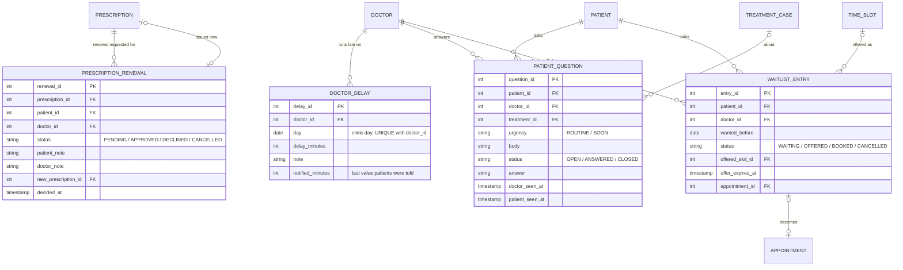

# ER Model — Hospital Appointment & Treatment Tracking App

## 1. Actors and scope

Three roles share one login table (`USER_ACCOUNT`) and are specialised into `PATIENT`, `DOCTOR` and `RECEPTIONIST`.

- **Patient** — browses doctors of any hospital, books/cancels appointments, sees current prescriptions, chats with doctors.
- **Doctor** — sees a timetable, records consultations, tracks treatment and condition, prescribes drugs, chats.
- **Receptionist** — guides patients to the right doctor, books for patients who did not book online, and handles schedule exceptions; does not see private doctor feedback/rating/popularity.

## 2. ER diagram (Mermaid)

### Between-visit care (migration 0008)

New table: `DOCTOR_WORKING_HOURS` (weekly bookable window). New table: `VISIT_TYPE` (built-in visit lengths per specialty). New columns on existing tables: `APPOINTMENT.visit_type_id` + `planned_minutes` + `seen_at`, `TIME_SLOT.created_by_receptionist_id` + `source`, `APPOINTMENT.checked_in_at`, `TIME_SLOT.held_for_patient_id` + `held_until` (waitlist hold), `DOCTOR.questions_open` + `reply_within_hours` + `reply_note`, `NOTIFICATION_OUTBOX.kind`; `TIME_SLOT.status` is now `AVAILABLE / BOOKED / BLOCKED`.

## 3. Key design decisions

1. **Supertype/subtype for users.** One `USER_ACCOUNT` (login, role) with 1:0..1 subtype tables. Chat messages can then reference a single sender key regardless of role.
2. **Region is independent of booking.** A patient's `region_id` is only profile data; slots belong to doctors, so a patient from a remote region books any hospital's slot with no phone numbers involved. `consultation_mode` (`IN_PERSON` / `ONLINE`) lets remote patients take online visits.
3. **Normal slots are derived; the receptionist handles exceptions.** `DOCTOR_WORKING_HOURS` plus the `VISIT_TYPE` table give the free times: the patient (or receptionist) picks a visit type, and the app offers only start times on a 5-minute grid where that type's built-in length fits, packed back to back; the last visit ends by the working-hours end. Lengths are agreed once with clinic staff and doctors and reviewed periodically against `APPOINTMENT.seen_at` (target ±5 minutes); doctors do not set lengths day to day. `TIME_SLOT.source = GENERATED` for these slots and `created_by_receptionist_id` is null. The receptionist creates or removes `EXCEPTION` slots or sets a generated slot to `BLOCKED`; generated slots are not manually deleted. A doctor's slots may not overlap (exclusion constraint in the SQL).
4. **Cancellation keeps history.** A cancelled appointment stays as a row with `status = CANCELLED`, and its slot returns to `AVAILABLE`. A partial unique index guarantees a slot has at most one non-cancelled appointment, which prevents double booking.
5. **Appointment status lifecycle:** `SCHEDULED → COMPLETED | CANCELLED | NO_SHOW`.
6. **Treatment tracking.** `TREATMENT_CASE` is the long-running condition being treated (diagnosis, severity, status). Each `CONSULTATION` (1:0..1 with an appointment) belongs to a case and records symptoms, notes, vitals and `condition_status` (`IMPROVING / STABLE / WORSENING / RESOLVED`). Reading the consultations of a case in time order gives the full progression of the patient's condition.
7. **Prescriptions.** One row per prescribed drug, linked to the consultation, the case, the drug catalogue entry, patient and doctor. Status is `ACTIVE → COMPLETED | DISCONTINUED`. Marking a drug done never deletes it: the patient view filters `status = 'ACTIVE'`, the doctor view shows everything.
8. **Private doctor metrics are separate entities.** `DOCTOR_REVIEW` and `DOCTOR_PERFORMANCE` (rating, popularity) are split from `DOCTOR` so that the public profile (specialization, bio, qualifications, experience) can be exposed to patients without any risk of leaking rating data. Private doctor metrics are not part of the receptionist role; they stay parked for a future management role. Patients may only insert a review for their own completed appointment (one per appointment).
9. **Chat.** One `CONVERSATION` per patient–doctor pair, many `MESSAGE`s. `message_type` (`TEXT / IMAGE / VOICE / FILE`) with `attachment_url` covers "speaking" via voice notes. Real-time calls would be handled by a separate service.
10. **Running late is per doctor per clinic day.** `DOCTOR_DELAY` holds one delay for today (clinic time, UTC+4); each scheduled visit today shows `expected_start = slot.start_time + delay`. `notified_minutes` stops a text for every small change. `APPOINTMENT.checked_in_at` records arrival without adding a status, so the status lifecycle above is unchanged.
11. **Renewal = new prescription.** Approving a `PRESCRIPTION_RENEWAL` creates a new `PRESCRIPTION` with the same drug, dose and frequency and `supersedes_id` pointing at the old one (same chain as substitution); an active old one becomes `COMPLETED`. History is never edited.
12. **Questions are not chat.** `PATIENT_QUESTION` is one short question and one answer, with an urgency, a reply window the doctor sets (`DOCTOR.reply_within_hours`) and "seen" receipts. The doctor gets no texts; the patient gets a text that an answer exists, never the clinical text itself.
13. **Waitlist holds instead of first-come booking.** A freed or new slot is held for the first matching `WAITLIST_ENTRY` (FIFO, `wanted_before` respected) via `TIME_SLOT.held_for_patient_id/held_until`; others cannot book it until the hold lapses. Lapsed holds are expired lazily and passed to the next patient.

## 4. Business rules not expressible as plain keys (enforce in service layer or triggers)

- `appointment.patient_id` must equal `treatment_case.patient_id` of its consultation.
- A doctor only creates treatment cases, consultations and prescriptions for patients who have an appointment with them.
- A review requires `appointment.status = COMPLETED`.
- Conversation creation requires at least one non-cancelled appointment between the pair.
- A patient may cancel only while `status = SCHEDULED` and before a cutoff time (policy parameter).
- Free times are derived from `DOCTOR_WORKING_HOURS` and the chosen `VISIT_TYPE.minutes` on a 5-minute grid; a booking occupies exactly its visit type's length; the last visit ends by the working-hours end. The receptionist creates only `EXCEPTION` slots, blocks generated slots, and removes exception slots; generated slots are not edited or deleted.
- A `BLOCKED` slot is not bookable. An exception slot is one ad-hoc visit of a chosen visit type (length from `VISIT_TYPE`), added only when the doctor agrees and the patient cannot wait for the next normal free time; it can sit outside normal working hours.
- Booking = one transaction: lock the slot row, check `AVAILABLE`, insert appointment, set slot `BOOKED`. Cancellation reverses it.
- Prescription becomes `COMPLETED` when the doctor marks it, or automatically by a job once `end_date` has passed.
- A delay can be set by the doctor (own) or a receptionist (own hospital's doctors); delay texts go out from 15 minutes and again only after a 10-minute change.
- Check-in only for a `SCHEDULED` visit on its clinic day, by the patient, the doctor or reception.
- At most one `PENDING` renewal per prescription; no renewal for a `DISCONTINUED` drug or a `RESOLVED`/`CLOSED` case.
- A patient may question only a doctor they have a non-cancelled appointment with, at most 3 open questions per doctor, and only while the doctor has `questions_open`.
- One active (`WAITING`/`OFFERED`) waitlist entry per patient per doctor. Booking a held slot is refused for everyone except the holder until `held_until`.

## 5. Access matrix

| Data | Patient | Doctor | Receptionist |
|---|---|---|---|
| Doctor public profile (specialization, bio, qualifications, experience) | read | read/edit own | read |
| Doctor rating, reviews, popularity | no | no | no |
| Time slots | read available | read own (timetable) | read all availability; create/update/delete exception slots; block generated slots; generated slots are not edited or deleted |
| Appointments | own: create, cancel, read | own: read, update status | read for hospital; create for non-online patients |
| Treatment cases, consultations | no | read/write own patients | no |
| Prescriptions | own, `ACTIVE` only | all, read/write | no |
| Chat | own conversations | own conversations | no |
| Doctor delay (running late) | read | read/write own | read/write own hospital |
| Check-in | own visits | own visits | own hospital's visits |
| Prescription renewals | own: request, cancel, read | own: approve, decline, read | no |
| Patient questions | own: ask, close, read | own: answer, close, read | no |
| Waitlist | own: join, accept, decline, leave | read own | read own hospital |

Implement the "no" cells with database views plus role-based checks in the API (and optionally Row-Level Security); the SQL file provides the views `v_doctor_public_profile` and `v_patient_active_prescription`.
